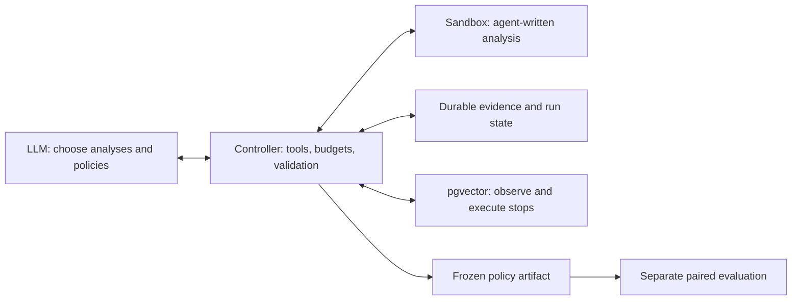

# FANNAgent

**An LLM-driven research agent that designs executable stopping policies for
filtered vector search.**

Built by [Daniel Arturi (darturi)](https://github.com/darturi). I designed the
agent architecture, domain tools, experimental workflow, and native pgvector
integration to investigate a concrete systems question: **when can a database
stop searching earlier, and what does that save in latency and cost in recall?**

The agent wrote its own analysis and exported stopping policies. One of those
policies reduced measured mean query latency by **12.69% including activation**
and **13.54% on reuse** over 300 training query/filter cases. Mean Recall@10
changed from **99.00% to 98.90%**. Later measurements on 180 held-out cases also
recorded latency reductions. [Inspect the policy and measurements](docs/results.md).

**Status: active research and development.** This branch presents the system,
the experimental approach, and a recorded agent-to-measurement case study.

## Explore the project

| Focus | What to inspect |
|---|---|
| [Architecture](docs/agent-design.md) | Model-directed investigation, typed domain tools, host authority, persistent evidence, budgets, and recovery |
| [The stopping oracle](docs/showcase/oracle.md) | Actual stopped executions used to identify search headroom and build training evidence |
| [Evaluation methodology](docs/showcase/evaluation.md) | Frozen candidates, matched controls, paired timings, grouped uncertainty, and separate held-out queries |
| [Data and queries](docs/showcase/workload.md) | The Reviews index, 768-dimensional vectors, three filter conditions, and exact query-group accounting |
| [The agent at work](docs/showcase/agent-run.md) | Ten model-selected actions, agent-written fitting code, validation feedback, six exports, and subsequent measured latency reductions |

## My approach: make the research loop measurable

I broke the problem into decisions that could be tested independently:

1. **Establish the opportunity.** Instrument native search and execute real
   checkpoint stops. Use a hindsight oracle to ask how much search might be
   avoidable while retaining the native result quality.
2. **Give the agent a useful experimental interface.** Supply qualified runtime
   features, training evidence, and tools with structured feedback. Let the model
   choose analyses, thresholds, and policy structure.
3. **Make model decisions inspectable.** Preserve commands, policy artifacts,
   tool receipts, evidence identities, and model charges. Feed validation errors
   back into the conversation so the agent can correct its proposals.
4. **Measure complete policies.** Freeze the agent's output, then time actual
   database executions against ordinary native search, including policy costs.
5. **Separate exploration from assessment.** Keep vector groups together, reserve
   held-out queries, and evaluate latency alongside recall using declared criteria.

The [evaluation walkthrough](docs/showcase/evaluation.md) connects these choices
to the recorded study. The [contribution statement](docs/CONTRIBUTIONS.md)
distinguishes my system engineering from upstream frameworks and model outputs.

## Architecture



The model directs research; the controller manages tool execution, evidence
permissions, spending, and evaluation. Policies are bounded decision trees over
available search-state features. They execute in the database search path
without an LLM call. Research runs happen outside live query serving.

The core builds on mini-swe-agent's base loop and model interfaces, with LiteLLM
dispatch. The [architecture walkthrough](docs/agent-design.md) follows an action
through the project-specific controller, command sandbox, host broker, backend,
and persistent store. The [recorded proposal study](docs/showcase/agent-run.md)
uses a specialized runner around the same budgeted model adapter and offline
evaluator.

## What I built

| Area | Engineering demonstrated | Code to inspect |
|---|---|---|
| Agent orchestration | Prepared-backend context, model/tool turns, recorded experiments, candidate selection, and explicit termination | [Controller](src/fannagent/controller.py) |
| Domain tools | Typed requests, policy validation, bounded correction feedback, and evidence references | [Tool broker](src/fannagent/broker.py) |
| Durable execution | Saved conversations, evaluation receipts, checkpoints, and recovery across interruptions | [Run store](src/fannagent/store.py), [recovery tests](tests/test_checkpoint.py) |
| Cost control | Per-attempt reservations, actual usage accounting, and conservative treatment of ambiguous charges | [Model adapter](src/fannagent/model.py), [accounting tests](tests/test_model.py) |
| Evaluation boundaries | Development/calibration/test separation, policy freeze, compatibility checks, and host-owned acceptance | [Study controls](src/fannagent/study.py) |
| Database integration | A separately packaged pgvector backend with native observation/stopping, prepared copies, and application sessions | [Companion source](https://github.com/darturi/FANN-Agent-pgvector/tree/portfolio-v1) |

Research happens outside live query serving. Provider-backed research can use a
networked model API; an accepted policy executes without an LLM in the query path.
The static cited primer supplies research guidance. The system does not perform
autonomous literature retrieval.

## A policy the agent produced

In the recorded conversation, the model inspected 2,397 measured stopping
outcomes, wrote threshold scans and a staged fitter, corrected a policy rejected
for excessive decision depth, and exported six proposals. The conversation used
ten provider attempts and recorded $0.530724 in model API charges.

One export, `cons_S32_64_128_t002`, became the selected policy in the subsequent
frozen-proposal timing study:

| Query set | Independent vector groups | Activation latency saving | Reuse latency saving | Native → policy mean Recall@10 |
|---|---:|---:|---:|---:|
| Training: 300 query/filter cases | 100 | 12.69% | 13.54% | 99.00% → 98.90% |
| Held-out: 180 query/filter cases | 60 | 11.67% | 12.38% | 99.50% → 98.94% |

These are measured arithmetic mean latency reductions against native search on
the recorded Reviews workload. Activation includes policy preparation and first
execution on warm data; reuse measures an already activated policy. The results
show a latency/recall tradeoff. The [case study](docs/results.md) provides absolute
timings, per-filter results, uncertainty, and the original study records.

Follow the [annotated agent run](docs/showcase/agent-run.md) from the model's
actions to the exact policy artifact and its later measurements. The
[validation record](docs/showcase/validation.md) documents engineering checks.

## Simulation

The verified first-run path uses the synthetic backend and a scripted model.
It needs no API key, database, Docker daemon, GPU, or paid model call. Installation
requires network access to obtain dependencies. Provide [uv](https://docs.astral.sh/uv/)
and Python 3.12 or 3.13; uv can provision the requested Python runtime.
The commands pin the published `portfolio-v1` snapshot so the example has a
stable source and dependency lock. Install from source as shown here; the
packages are not currently published on PyPI.

```sh
git clone --branch portfolio-v1 --single-branch https://github.com/darturi/FANN-Agent.git
cd FANN-Agent
uv sync --frozen --python 3.12

demo_dir="$(mktemp -d)"
export MSWEA_GLOBAL_CONFIG_DIR="$demo_dir/mini-config"
export MSWEA_SILENT_STARTUP=1
export LITELLM_LOCAL_MODEL_COST_MAP=True

uv run --frozen fannagent init --backend fake --output "$demo_dir/fake.yaml"
uv run --frozen fannagent doctor "$demo_dir/fake.yaml"
uv run --frozen fannagent prepare "$demo_dir/fake.yaml" --run "$demo_dir/run"
uv run --frozen fannagent run "$demo_dir/fake.yaml" --run "$demo_dir/run" --steps 2
uv run --frozen fannagent resume --run "$demo_dir/run"
uv run --frozen fannagent evaluate --run "$demo_dir/run"
uv run --frozen fannagent experiments --run "$demo_dir/run"
uv run --frozen fannagent report --run "$demo_dir/run"
uv run --frozen fannagent status --run "$demo_dir/run"
uv run --frozen fannagent clean --run "$demo_dir/run"
```

Expected milestones are `interrupted` after the two-step run, `frozen` after
resume, and an evaluation with `status: accepted`, `valid: true`, and
`simulated: true`. Status records three completed experiments and a model ledger
with `committed_usd: "0"` and `calls: []`. The report remains at
`$demo_dir/run/REPORT.md` after cleanup.

This demonstrates the lifecycle with predetermined actions and synthetic latency.
It establishes no database speedup or model-directed discovery. The annotated
real run above supplies recorded provider-backed behavior. See the
[local-demo guide](docs/showcase/local-demo.md) for installation details and output.

## Development and the database backend

```sh
uv sync --frozen --extra dev --python 3.12
uv run --frozen pytest -m 'not integration'
uv run --frozen ruff check src tests
uv run --frozen mypy src/fannagent/api --check-untyped-defs --follow-imports=silent --ignore-missing-imports
uv build
```

The [pgvector extension](https://github.com/darturi/FANN-Agent-pgvector/tree/portfolio-v1)
is optional for the simulation and maintained as a separate distribution. Its
database requirements and historical native qualification are documented there.
Neither the demo nor ordinary core CI connects to a research database. See the
[operations reference](docs/USAGE.md) and [extension API](docs/EXTENSIONS.md) for
advanced workflows. Source installation is the supported portfolio path; public
package-registry or container-image availability is not required by these commands.

Licensed under [MIT](LICENSE), with [third-party notices](NOTICE.md).
This portfolio narrative is maintained on `public-facing`. The original
verified simulation release is pinned at `portfolio-v1`, as used by the clone
command above. Ongoing research uses separate branches and workspaces.
