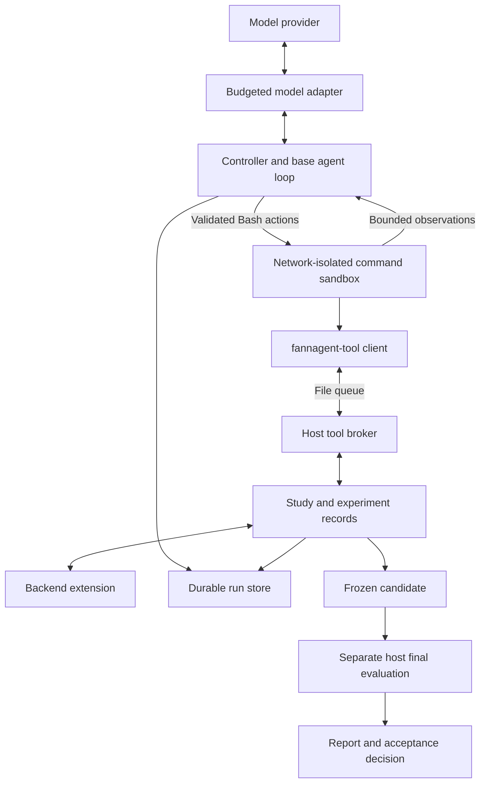

# FANNAgent: agent design

FANNAgent is an offline research agent for stopping policies in filtered
approximate nearest-neighbor search. A vector database searches for nearby items
that also satisfy a filter. Stopping earlier can save work, but can also miss good
results. The agent investigates that tradeoff using tools and measured evidence.

The engineering problem is to let a model choose useful experiments while keeping
spending, evidence access, execution, and policy acceptance under controller
authority. This document follows those boundaries through the existing source.

Start with the [showcase overview](showcase/README.md) for a shorter introduction.
This is a source walkthrough prepared on October 22, 2026; linked tests describe
existing coverage and were not executed for this documentation pass.

## Research and serving

During research, a model chooses queries, analyses, experiments, and candidate
stopping rules. Provider-backed runs can make networked model requests. Here,
**offline** means that policy research happens outside the live query-serving path.

The research output is a bounded policy artifact interpreted using the selected
backend's runtime features. Opening an application policy session requires an
accepted final evaluation or an explicitly recorded compatible deployment.
Policy execution in that session does not call the LLM.

See [policy validation and reference interpretation](../src/fannagent/api/policy.py),
[study selection and evaluation](../src/fannagent/study.py), and
[the application session entry point](../src/fannagent/client.py).

## Architecture

The provider adapter, controller, broker, and study code execute on the trusted
host/controller side. Model-generated commands execute in the sandbox. The file
queue provides access to host tools even though the command container has no
network. Final evaluation is an explicit host operation after candidate freeze;
it is not a development tool available to the model.

FANNAgent uses mini-swe-agent's `DefaultAgent` and model interfaces, with LiteLLM
providing model dispatch. The project-specific orchestration, tool services,
accounting, evidence handling, and evaluation surround those components. The
integration is visible in [the controller](../src/fannagent/controller.py),
[model adapters](../src/fannagent/model.py), and
[declared dependencies](../pyproject.toml).

## Model choices and controller authority

| Concern | Model chooses | Controller enforces |
|---|---|---|
| Investigation | Hypotheses, permitted queries, and analyses | Development scope, tool schemas, and evidence permissions |
| Tool use | Bash actions and domain-tool requests | Response parsing, argument validation, sandbox execution, and bounded feedback |
| Candidate policy | Conditions, thresholds, feature groups, and stopping decisions | Declared runtime features, bounded policy validation, and backend compatibility |
| Spending | Whether to request another action within the available run | Request reservations, charge accounting, configured limits, and termination |
| Candidate checkpoint | Which eligible calibration to designate as a fallback | Eligibility checks and evidence/identity checks before freezing |
| Completion | Submit a calibrated candidate or abstain | Freeze rules, separate final testing, and application acceptance |

This separation lets the model direct exploration while preserving host authority
over operations that determine whether a proposal can be accepted.

## Following one action through the system

1. **Prepare context.** `explore` checks prepared-backend qualification and required
   capabilities. `Tools.startup_context` supplies backend identity, development
   query information, runtime feature guidance, budget information, and references
   to larger artifacts. The initial conversation is saved before the first model
   request.
2. **Request and validate an action.** `BudgetedModel.query` reserves a provider
   attempt, records its response and charge, and parses its Bash tool calls.
   `parse_response` validates the response shape and all actions before returning
   them to the base agent loop.
3. **Execute through the sandbox.** `ContainerEnvironment.execute` checks shell
   syntax and executes the action. The model can use Python for analysis and
   `fannagent-tool` for domain operations. The tool client sends requests through
   the file queue to the host broker.
4. **Admit a measurement.** The host validates operation arguments, checks study
   permissions, and, when required by research mode, records the experiment's
   pending operation before execution. The backend performs the requested work;
   the host retains evidence and returns the permitted result or artifact reference.
5. **Observe and continue.** The environment returns output and error feedback to
   the model. The controller saves the trajectory and submission-recovery state.
   The model can use that observation to revise its next request or conclusion.
6. **Freeze and evaluate separately.** An eligible submission freezes the exact
   policy. Exploration closes. A separate final evaluation determines acceptance;
   freezing alone does not authorize an application session.

The main path runs through [controller.py](../src/fannagent/controller.py),
[model.py](../src/fannagent/model.py), [environment.py](../src/fannagent/environment.py),
[tool_client.py](../src/fannagent/tool_client.py),
[broker.py](../src/fannagent/broker.py), and [study.py](../src/fannagent/study.py).
This is a structural walkthrough, not a transcript of a newly executed run.

## Tool interfaces and experimental feedback

The model-facing function tool is Bash. Domain operations are exposed through
the `fannagent-tool` client and validated by host-side `Tools` methods.

| Tool family | Purpose and evidence boundary |
|---|---|
| `inspect`, `queries`, `sample`, `artifact` | Orient the model and retrieve permitted development evidence |
| `experiment` | Register a hypothesis and comparison, then record an evidence-linked conclusion |
| `count`, `descriptors`, `probe`, `audit`, `labels` | Investigate permitted queries, execution observations, and actual stopping outcomes |
| `screen`, `development_evaluate` | Compare candidates using preliminary screening or the development workload |
| `validate`, `calibrate` | Check policy structure or obtain approved calibration aggregates |
| `evaluation_status`, `submit` | Retrieve durable evaluation status/results or freeze an eligible candidate |

Offline descriptors and exact labels can inform investigation. The policy
validator limits executable policies to the runtime profile's declared features.
Large development evidence can be fetched by artifact hash instead of placing all
vectors and traces into the conversation. Calibration results expose approved
aggregates while row-level calibration evidence remains private.

Invalid model responses, shell syntax, tool arguments, queries, and policies
receive bounded error details with correction hints. Host tracking preserves
tool errors even when a shell command suppresses its output. Three consecutive
invalid turns terminate exploration; a successful turn resets the streak.
Provider attempts remain accounted for when their returned actions are invalid.

See [tool dispatch](../src/fannagent/broker.py),
[submission validation and tracking](../src/fannagent/submission.py),
[recovery coverage](../tests/test_submission_resilience.py), and
[evaluation receipt coverage](../tests/test_evaluation_jobs.py).

## Context and research guidance

The `guided` mode supplies a pinned, cited primer and requires a short experiment
plan before measurement, followed by a conclusion referencing recorded evidence.
`protocol_only` uses the experiment protocol without the primer. `baseline`
retains the original exploration protocol. The model still chooses experiments.

The host pins the guidance snapshot and prompt identity to the run. Resume uses
the saved conversation and initial context. This makes the supplied research
context inspectable across interruptions and package changes. The journal checks
evidence references and records outcomes; it does not certify that the model's
scientific interpretation is correct. The primer is static cited guidance, not
an autonomous literature-search or retrieval system.

See [guidance preparation](../src/fannagent/guidance.py),
[experiment records](../src/fannagent/experiments.py),
[protocol details](RESEARCH_GUIDANCE.md),
[startup-context coverage](../tests/test_startup_context.py), and
[guidance coverage](../tests/test_research_guidance.py).

## Cost accounting and recovery

Each provider attempt reserves a maximum request charge before dispatch.
The adapter disables automatic provider retries and accounts for its own attempts
individually. It saves the response and settles usage before parsing returned
actions. Missing usage or an ambiguous failure retains the reserved amount as
uncertain. Recovery treats an outstanding reservation as uncertain, and resume
cannot change the saved spending contract.

These controls depend on configured pricing, verified token bounds, the ceiling,
and any configured allowance. The ledger covers model API charges; database
hosting and other infrastructure costs are outside its scope. Provider bound
violations disable further calls. This is a scoped accounting contract, not a
guarantee about every possible provider or total project cost.

The run store uses SQLite state and content-hashed artifacts. Development artifacts
and private evidence have distinct access scopes. Resume restores the saved
messages, counters, and recovery state. Evaluation receipts allow retrieving a
completed result without repeating its measurements; unknown operations are not
automatically replayed.

If spending ends after the model designated an eligible calibration checkpoint,
the controller can freeze it using cached evidence after stopping the sandbox and
broker. That path makes no extra model call or measurement. A missing or ineligible
checkpoint produces an explicit outcome. Final evaluation remains separate.

See [the ledger](../src/fannagent/budget.py), [run storage](../src/fannagent/store.py),
[evaluation receipts](../src/fannagent/evaluation_jobs.py),
[provider accounting coverage](../tests/test_model.py), and
[checkpoint and exhaustion coverage](../tests/test_checkpoint.py).

## Execution and evaluation boundaries

The provider-backed command container has a read-only root filesystem, dropped
Linux capabilities, resource limits, and no network. It mounts the development
workspace and communicates with host tools through the file broker. A command
timeout stops the container. The host/controller, Docker administrators, and
installed backend extensions are trusted. This design does not establish a
general security guarantee for arbitrary extensions or deployment environments.

The study separates development, calibration, and final-test query groups.
Development tools restrict access to protected queries and private artifacts.
Submission requires accepted calibration for the exact candidate. The frozen
envelope binds policy, workload, prepared-copy, and compatibility identities.
Final evaluation consumes its entitlement before measurements; an interrupted
final test cannot silently become a fresh test of the same run. Application
sessions check acceptance and compatible policy identity.

The core assesses configured recall and latency criteria using grouped evidence.
Individual research campaigns can specify additional gates; their criteria and
findings must be read from their own records. Calibration aggregates remain part
of selection and do not constitute a final generalization guarantee.

See [workload grouping](../src/fannagent/workload.py),
[study enforcement](../src/fannagent/study.py),
[statistical summaries](../src/fannagent/evaluation.py),
[session checks](../src/fannagent/client.py),
[container integration coverage](../tests/test_container_integration.py),
[evaluation coverage](../tests/test_evaluation.py), and
[deployment coverage](../tests/test_deployment.py).

## Backend extensibility and engineering ownership

The core defines study orchestration, domain-tool services, run state, accounting,
and acceptance. Extensions supply database-specific preparation, observation,
native stopping, exact references, compatibility checks, sessions, and cleanup.
Descriptors and capability checks establish which operations a backend supports
before a study or provider request proceeds.

The core ships a synthetic backend. The pgvector integration is a separate package;
other database integrations are future work. See [backend status](BACKENDS.md),
[extension API v1](EXTENSIONS.md), [the public API](../src/fannagent/api/__init__.py),
and [SDK coverage](../tests/test_extension_sdk.py).

The repository demonstrates agent orchestration, domain-tool design, context and
evidence management, cost accounting, interruption recovery, and experimental
evaluation. Those are the engineering areas to explain in an application or
interview. Individual authorship and collaborator credit should be finalized for
the selected public snapshot; this document identifies component responsibilities
without assigning every component to one person.

## Evidence and next showcase work

Source links explain implemented mechanisms. Test links identify checks written
for those mechanisms; they do not report a new test run or establish scientific
success. Existing campaign summaries are linked from the
[showcase overview](showcase/README.md).

An annotated provider-backed trajectory and a freshly verified clone-to-demo path
remain future deliverables in the
[application-ready plan](APPLICATION_READY_IMPLEMENTATION_PLAN.md). The existing
scripted simulation demonstrates lifecycle behavior with synthetic measurements;
it does not demonstrate model-directed discovery or database performance.
