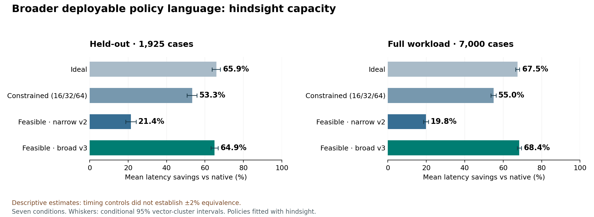

# Broader feasible oracle results

The prior work was committed as `795db05` before implementation.

Both broader policies are ordinary `fannagent.broad-stop.v3` artifacts, submitted through the agent tool and executed by its trusted native compiler/VM. They use hindsight on their respective reported cohort. This measures representational capacity, not agent discovery or generalization.

| Oracle | Held-out savings | Full-workload savings |
|---|---:|---:|
| oracle_ideal | 65.89% | 67.48% |
| oracle_constrained | 53.28% | 55.00% |
| oracle_feasible · narrow v2 | 21.37% | 19.80% |
| oracle_feasible · broad v3 | 64.95% | 68.39% |

Fresh measurements share one balanced allocation and native baseline. Savings use the ratio of mean latency, equally weighted over all seven conditions. The historical narrow-policy values were 27.20% held-out and 17.98% full; the table reruns those same policies in the new comparison.

Strict control equivalence failed in both cohorts. Treat these as descriptive hindsight estimates. Unresolved timing bias prevents interpreting the broader full-workload policy's apparent lead over the ideal oracle as a real advantage. The broader interface expands expressions, causal feature access, and checkpoints beyond 16/32/64; its gains reflect all three changes.

| Cohort | Native mean | Broader mean | Broader saving, conditional 95% interval | Gain over narrow |
|---|---:|---:|---:|---:|
| Held-out: 1,925 cases | 11.647 ms | 4.083 ms | 63.01–66.84% | 43.57 pp |
| Full: 7,000 cases | 11.933 ms | 3.772 ms | 67.34–69.41% | 48.60 pp |

| Six filtered conditions only | Ideal | Constrained | Narrow feasible | Broad feasible |
|---|---:|---:|---:|---:|
| Held-out | 61.62% | 48.21% | 14.28% | 60.56% |
| Full | 63.49% | 50.21% | 13.43% | 64.69% |

The fitter first constructs balanced threshold trees over causal frontier distance; ambiguous values use richer cost-guided trees. Such fine thresholds can memorize a finite cohort through causal observations. No query IDs, truth labels or future observations are runtime inputs. An agent with the authorized offline evidence and workspace could generate these exact JSON artifacts. Quality on future workloads is not established.

| Cohort | Broader stops | Matches ideal stop | Native recall losses | Result-count losses | All-condition control equivalence |
|---|---:|---:|---:|---:|---|
| Held-out | 1923 | 1924 / 1925 | 0 | 0 | Not established |
| Full | 6996 | 6994 / 7000 | 0 | 3 | Not established |

Outside the held-out fitting cohort, test-fitted recall losses are retained: narrow 147, broad 2353 / 5,075 cases. The quality gate applies to each policy's intended cohort.

The ideal oracle chooses hindsight stops without policy collection/VM costs; constrained restricts those choices to 16/32/64/continue; narrow feasible uses the prior three-clause/four-comparison language; broad feasible uses one complete v3 policy. Policies are best found fits. Earliest safe work stops and these timings do not prove a mathematical wall-clock optimum.

All source cases and full prefix chains were bridged on the original graph. An independent canonical execution verified frontier/work at every captured checkpoint. Before timing, all 84,000 family/case outputs and compiled decisions were checked. Timing retained 336,000 requests: four samples per family/case, with every family on every reader. Feature collection and VM execution are inside the primary timer; ideal lookup routing is outside. No samples or outliers were removed.

The canonical logger retains raw floating-point cosine values while the native collector clips them into [0,2]. Qualification checks the existing native projection, requiring agreement within 1e-12 and boundary corrections no larger than 1e-6. All 1,104,761 checkpoint observations passed; 196 boundary roundoff events were recorded (maximum 1.19e-07). The initial unprojected comparison failed before quality/timing; its evidence and entire reservation are retained. This repair did not change the native module, fitted policies or primary timing method.

Uncertainty uses 20,000 fixed-seed vector-cluster draws, conditional on the fitted policies and one allocation. Strict control equivalence requires every condition's 90% interval for each empty-language/native-clone control inside ±2%. Where that fails, treat the table as descriptive estimates. Bootstrap intervals omit fitting uncertainty and variability between allocations.

New runs used 7,783 allocated seconds, including 122 seconds from the user-cancelled allocation and 207 seconds from failed qualification. Completed stages issued 463,192 known ANN requests; the failed stage adds between 1 and 1,024 requests, with its entire reserved window charged. All 464,896 charged reservations and allocated time remain within the predeclared six-hour/two-million envelope. The user explicitly resumed after pausing; frozen policies and the primary timing method were unchanged. Four physical CPUs and 48 GiB per allocation; zero provider calls, fresh exact queries or automatic retries.

See `report.json` for condition-level quality, savings, uncertainty and control results; `accounting.json` for hashes and raw evidence locations; normal policy JSON, fit certificates and `agent-submission.json` for deployment artifacts. Raw archives remain outside Git.
